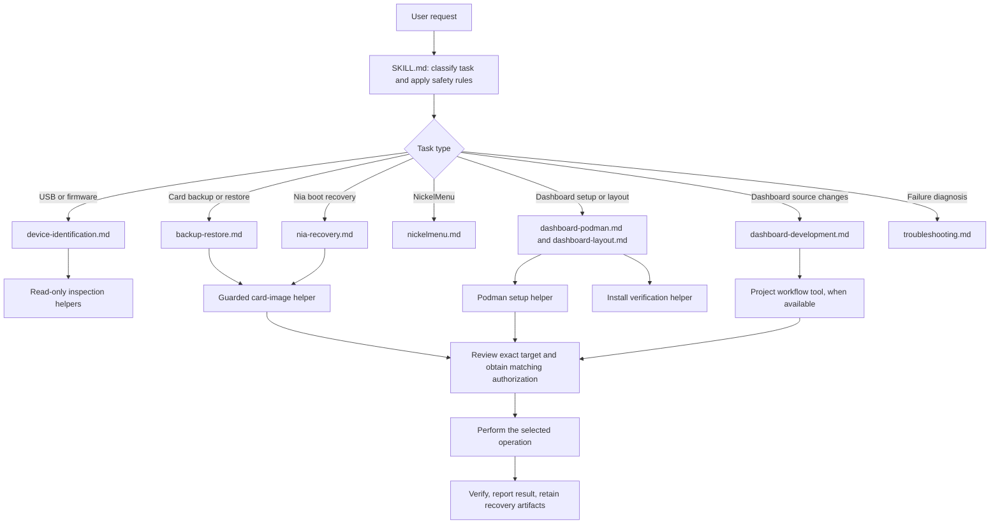

# Kobo E-Reader Maintenance

A portable Agent Skill for safely diagnosing and maintaining Kobo e-readers. It covers USB and firmware identification, full microSD backups and restores, Kobo Nia N306 recovery, NickelMenu configuration, and setup or development of the Kobo Home Assistant Dashboard.

The skill is coding-agent neutral: its core instructions use the open `SKILL.md` format and its bundled helpers are shell scripts for Linux. Codex-specific discovery metadata is optional and kept separate from the core instructions.

## What this package does

- Identifies connected Kobo storage and firmware without exposing secrets.
- Backs up and verifies a whole Kobo microSD card, restores a trusted image, and prepares the model-specific Kobo Nia N306 recovery card.
- Runs the Kobo HA Dashboard release setup application through Podman for USB-based initial installation and layout configuration.
- Documents safe NickelMenu edits and update behavior.
- Guides dashboard layout changes, source previews, ARM builds, SSH deployment, verification, log review, and rollback when the dashboard source repository provides its own workflow tool.
- Routes firmware-update failures and boot problems to model-appropriate troubleshooting.

This package does not include Kobo firmware, disk images, downloaded dashboard binaries, Home Assistant credentials, or device-specific configuration. It does not grant permission to perform destructive or live operations.

## Package map

```text
kobo-ereader-maintenance/
├── README.md                         # This overview and integration guide
├── SKILL.md                          # Portable activation and safety instructions
├── agents/
│   └── openai.yaml                   # Optional Codex display metadata
├── references/
│   ├── device-identification.md      # USB, mounts, firmware and model identification
│   ├── backup-restore.md             # Raw card backup and ordinary restore
│   ├── nia-recovery.md               # Kobo Nia N306 factory recovery-card workflow
│   ├── dashboard-podman.md          # Release setup UI in Podman
│   ├── dashboard-layout.md          # Dashboard configuration and e-ink layout
│   ├── dashboard-development.md     # Source preview, build, SSH deploy and rollback
│   ├── nickelmenu.md                 # NickelMenu ownership, syntax and updates
│   └── troubleshooting.md            # Boot, USB, network, sleep and dashboard faults
└── scripts/
    ├── kobo-device-info.sh           # Read-only mounted-device discovery
    ├── kobo-card-image.sh            # Inspect, back up, restore, or arm Nia recovery
    ├── run-dashboard-setup-podman.sh # Run the downloaded setup app in Podman
    └── verify-dashboard-install.sh   # Verify install files without printing secrets
```

## Architecture and task flow

The `SKILL.md` entrypoint selects the relevant reference and helper. Diagnosis stays read-only; a mutation is a separate step that requires authorization matching the exact target and action.



## Requirements

### General

- An agent that supports the Agent Skills `SKILL.md` format.
- For bundled scripts: Linux, Bash, and common GNU/Linux utilities.

### Specific operations

- Device discovery: `lsblk`, `findmnt`, and standard mount utilities.
- Raw-card operations: root access, `dd`, `cmp`, `sha256sum`, `sfdisk`, `lsblk`, `blockdev`, and related util-linux/coreutils tools. Nia recovery also needs filesystem tools such as `e2fsck`/`debugfs`.
- Release setup UI: Podman, network access to the selected release and image registry, and a mounted, writable Kobo USB volume.
- Source development workflow: use the dashboard repository's own toolchain and `tools/kobo-dashboard` when available. Its README and `AGENTS.md` are authoritative for that checkout.

If an optional tool is unavailable, use the references to guide an equivalent read-only workflow. Do not weaken target checks or authorization boundaries to work around missing dependencies.

## Install and integrate

Install or link the **entire skill directory**, not just `SKILL.md`, because the entrypoint links references and executable helpers. Replace `AGENT_SKILLS_ROOT` with the local path where this repository is checked out.

### Codex

Codex can discover this skill from a project `.agents/skills/` directory or a user-level `~/.agents/skills/` directory. For project-local development:

```bash
AGENT_SKILLS_ROOT=/path/to/agent-skills
mkdir -p .agents/skills
ln -s "$AGENT_SKILLS_ROOT/skills/kobo-ereader-maintenance" \
  .agents/skills/kobo-ereader-maintenance
```

For user-wide discovery, link the skill under `~/.agents/skills/` instead. Start a new Codex session after installing or updating it. The included `agents/openai.yaml` supplies display text; it is not required for the portable skill instructions.

### Other coding agents

Use the discovery location documented by the target agent and copy or link the complete directory. Examples include `.claude/skills/` for Claude Code and `.agents/skills/` for portable discovery in Gemini CLI or OpenCode. Keep `SKILL.md`, `references/`, and `scripts/` together. Client-specific metadata may be omitted when unsupported.

## How to use

Invoke the skill by name or describe the Kobo task. The agent should read `SKILL.md`, then only the references relevant to the task. Start with the narrowest workflow:

| Need | Start here |
| --- | --- |
| Identify a connected Kobo or inspect firmware | `references/device-identification.md` |
| Back up or restore the internal card | `references/backup-restore.md` |
| Recover a confirmed Kobo Nia N306 boot failure | `references/nia-recovery.md` |
| Install the dashboard release tool over USB | `references/dashboard-podman.md` |
| Edit pages, cards, entities, sleep, or display settings | `references/dashboard-layout.md` |
| Change NickelMenu entries | `references/nickelmenu.md` |
| Develop, preview, deploy, verify, or roll back dashboard source | `references/dashboard-development.md` |
| Diagnose a failed install, update, network, or boot | `references/troubleshooting.md` |

Read helper usage before operating on a device. The discovery, Podman setup, and install verification helpers support `--help`; the card-image helper prints its usage when called without arguments. Its `inspect` mode is read-only. For example:

```bash
skills/kobo-ereader-maintenance/scripts/kobo-device-info.sh --help
skills/kobo-ereader-maintenance/scripts/kobo-card-image.sh
skills/kobo-ereader-maintenance/scripts/run-dashboard-setup-podman.sh --help
skills/kobo-ereader-maintenance/scripts/verify-dashboard-install.sh --help
```

For destructive card operations, the workflow uses explicit device confirmation and a dry run. Review the resolved whole-disk identity immediately before writing. A backup request does not authorize overwriting a card. For live dashboard updates, confirm the exact device and deployment scope before applying changes.

## Safety and privacy

- Never select a disk from a remembered `/dev/sdX` example, ordering, or size alone. Identify the removable whole disk, partitions, mounts, and transport immediately before a write.
- Keep the original Kobo microSD and a verified image. Prefer a separate replacement card for restores.
- Restore only from a trusted checksum and compare written data after the operation. A clone of a corrupted card preserves that corruption.
- Treat raw images, Kobo setup state, Home Assistant tokens, dashboard configuration, logs, serial numbers, and private network details as sensitive. Do not commit or publish them.
- Never print token contents or `.kobo-ha/config.yaml`. Redact secrets and private addresses before sharing logs.
- Keep personal NickelMenu entries in a separate custom file; do not edit NickelMenu's managed `doc` file or the dashboard-generated entry.
- Do not expose unauthenticated remote shell services on the Kobo as a convenience. Only configure remote access when the user explicitly asks for it.
- Eject/unmount media safely. Do not interrupt a firmware update or factory recovery while it is running.

## Maintenance and validation

When changing this skill, keep the `SKILL.md` route list aligned with references and script names. Validate the repository before committing:

```bash
python3 scripts/validate_skills.py
PYTHONDONTWRITEBYTECODE=1 python3 -m unittest discover -s tests
```

The repository validator checks skill metadata, links, helper permissions, and tracked content for common privacy/security violations. Review its findings without copying any secret values into output.

## Related documentation

- [Agent Skills specification](https://agentskills.io/specification)
- [Agent Skills authoring best practices](https://agentskills.io/skill-creation/best-practices)
- [Kobo HA Dashboard upstream](https://github.com/armamut/kobo-ha-dashboard)
- [NickelMenu upstream documentation](https://pgaskin.net/NickelMenu/)
